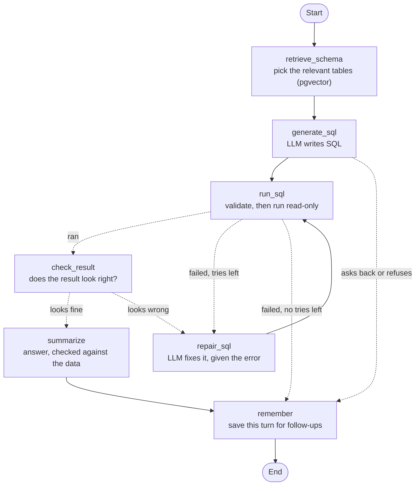

# QueryMind

[](https://github.com/Mohamed-Dahy/querymind/actions/workflows/ci.yml)

**An AI data analyst for company databases.** Ask a question in plain English and get back the answer,
the SQL that produced it, and a result table (charts are on the roadmap).

> "Which employee handled the most orders?" → "Margaret Peacock handled the most orders, with 156." + SQL + table

QueryMind is built to **assist** data teams, not replace them. It handles routine questions so analysts
can focus on deeper work, and it always shows its SQL so every answer can be checked.

> 🚧 **Status: working agent.** Ask questions through a chat UI or an HTTP API. When a query fails, the agent
> reads the database's error and fixes its own SQL; when a result looks wrong (no rows, duplicated rows), it
> checks again and warns you. When a question is ambiguous ("best customers": by revenue or by orders?) it asks
> back, and it politely refuses requests to change data. Every answer comes with a **confidence level** (High /
> Medium / Low) and the reasons behind it. Follow-up questions work too: "Top 5 customers by revenue", then
> "only for 1997", then "break that down by country". On a 30-question test set with known answers it gets
> **30/30** right (29/30 before self-correction). A **semantic layer** teaches it the company's own terms ("key
> accounts", "active customers", "turnover"): on 13 such questions it goes from 5/13 to 13/13. Next: larger
> databases, with retrieval of only the relevant tables.

---

## How it works

```
Question → LLM writes SQL → safety check → run on a read-only DB user → plain-language answer + table + SQL
```

The steps run as a [LangGraph](https://langchain-ai.github.io/langgraph/) agent graph. When a query is unsafe,
fails in the database or runs too long, the error goes back to the LLM, which writes a fixed query (up to 3 tries).
Before writing SQL, the LLM may instead ask a clarifying question with options (the question has several
reasonable meanings) or refuse (the user asks to change data); then no SQL runs. Every fixed query is checked
again before it runs. A result that looks wrong (no rows, duplicated rows) gets one
more try, and any warning that's left is shown with the answer.

Next to the schema, the LLM gets the company's **business definitions** from a reviewed YAML file (the semantic
layer): exact SQL for metrics like revenue or "key account", other names for tables ("clients" = customers) and
the preferred joins. Each one is checked against the database and run in the tests.

On a bigger database it doesn't send every table to the LLM. Each table and business term is described once and
stored as an embedding in **pgvector**; for each question, the closest tables are found, plus the tables needed
to join them and the ones a business term reads. On the 25-table demo database that's about 40% of the schema per
question. Retrieval only decides what the LLM *sees*: what it may *query* is still every table the read-only user
can read. If the search fails, the whole schema is sent and the logs say so.

Each turn of a conversation is remembered (the question, its SQL and the shape of its result, never the rows),
so the next question can build on it. Only the last 5 turns are kept.



The answer is checked too: every number in it must appear in the query result, or a plain sentence built from
the data is shown instead.

## Safety first

QueryMind runs SQL written by an AI, so the database is protected in layers:

- **Read-only database user.** The agent connects as `analyst_ro`, which can only `SELECT` from business
  tables. Every write (INSERT, UPDATE, DELETE, DROP, …) is blocked by Postgres itself. Tests prove this.
- **SQL validation.** Every generated query is parsed (sqlglot) and must be a single read-only `SELECT`, using
  only allowed tables and an allowlist of functions. Writes hidden in CTEs, system catalogs, `pg_sleep` and
  similar tricks are rejected before anything runs.
- **Query timeout and row limit.** Queries are stopped after 10 seconds and return at most 1,000 rows.
- **Audit trail.** Every question, its SQL and its outcome is logged.
- **Secrets stay out of code.** All passwords and API keys come from environment variables.
- *Coming later:* PII masking and per-user permissions.

## Tech stack

| Area | Tools |
|---|---|
| Language | Python 3.12, [uv](https://docs.astral.sh/uv/) |
| Database | PostgreSQL 16 + pgvector (Docker) |
| Retrieval | Gemini embeddings, pgvector cosine search |
| Agent | LangGraph |
| LLMs | Groq and Gemini through one interface (LangChain wrappers) |
| SQL safety | sqlglot |
| API / UI | FastAPI, Streamlit |
| Config | pydantic-settings |
| Quality | ruff, mypy (strict), pytest, pre-commit |
| CI | GitHub Actions |
| Planned | AWS (Bedrock, ECS), Terraform |

---

## Getting started

### Requirements
- [uv](https://docs.astral.sh/uv/getting-started/installation/) (it installs Python 3.12 for you)
- [Docker Desktop](https://www.docker.com/products/docker-desktop/)
- An API key from [Groq](https://console.groq.com/keys) or [Google AI Studio](https://aistudio.google.com/apikey)

### Setup

```bash
git clone https://github.com/Mohamed-Dahy/querymind.git
cd querymind

uv sync                                # install dependencies
cp .env.example .env                   # then edit .env: passwords + your API key
                                       # (Windows PowerShell: Copy-Item .env.example .env)

docker compose up -d --wait            # start Postgres + pgvector on 127.0.0.1:5433
uv run python data/seed_northwind.py   # load the sample data + create the read-only user
uv run python data/seed_chinook.py     # load the second sample (a music store) next to it
uv run python scripts/build_index.py   # index the tables for retrieval (needs a Google AI Studio key)
```

Without a Google key the app still works: it sends the whole schema and logs a warning.

### Ask questions

```bash
uv run uvicorn querymind.api.main:app     # the API on http://127.0.0.1:8000 (docs at /docs)
uv run streamlit run ui/app.py            # in a second terminal: the chat UI on http://localhost:8501
uv run python scripts/ask.py "How many orders were placed in 1997?"   # or straight from the terminal
```

### Measure accuracy

```bash
uv run python -m evals.run --suite golden   # 30 questions with known answers (uses real LLM calls)
uv run python -m evals.run --suite golden --max-attempts 1   # the same, with self-correction off
uv run python -m evals.clarify               # does it ask back only when a question is ambiguous?
uv run python -m evals.retrieval             # does retrieval find the tables each question needs?
uv run python -m evals.run --suite chinook --schema-retrieval off   # the whole schema, for comparison
```

### Run the checks

```bash
uv run pytest                    # all tests (integration tests need the database running)
uv run pytest -m "not integration"  # unit tests only
uv run ruff check .              # lint
uv run mypy                      # type-check
```
