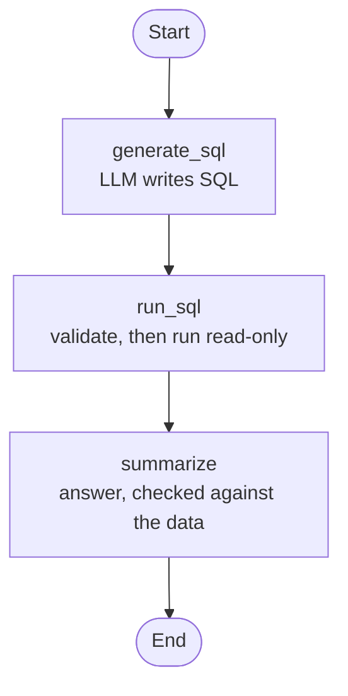

# QueryMind

[](https://github.com/Mohamed-Dahy/querymind/actions/workflows/ci.yml)

**An AI data analyst for company databases.** Ask a question in plain English and get back the answer,
the SQL that produced it, and a result table (charts are on the roadmap).

> "Which employee handled the most orders?" → "Margaret Peacock handled the most orders, with 156." + SQL + table

QueryMind is built to **assist** data teams, not replace them. It handles routine questions so analysts
can focus on deeper work, and it always shows its SQL so every answer can be checked.

> 🚧 **Status: first working version.** Ask questions through a chat UI or an HTTP API. On a 30-question
> test set with known answers it gets **29/30** right. Next: self-correcting agent, then larger databases.

---

## How it works

```
Question → LLM writes SQL → safety check → run on a read-only DB user → plain-language answer + table + SQL
```

The steps run as a [LangGraph](https://langchain-ai.github.io/langgraph/) agent graph, so the next features
(fixing its own SQL errors, asking clarifying questions) are new arrows in the graph:



The answer is checked too: every number in it must appear in the query result, or a plain sentence built from
the data is shown instead.

## Safety first

QueryMind runs SQL written by an AI, so the database is protected in layers:

- **Read-only database user.** The agent connects as `analyst_ro`, which can only `SELECT` from business
  tables. Every write (INSERT, UPDATE, DELETE, DROP, …) is blocked by Postgres itself. Tests prove this.
- **SQL validation.** Every generated query is parsed (sqlglot) and must be a single read-only `SELECT`, using
  only allowed tables and an allowlist of functions. Writes hidden in CTEs, system catalogs, `pg_sleep` and
  similar tricks are rejected before anything runs.
- **Query timeout and row limit.** Queries are stopped after 10 seconds and return at most 1,000 rows.
- **Audit trail.** Every question, its SQL and its outcome is logged.
- **Secrets stay out of code.** All passwords and API keys come from environment variables.
- *Coming later:* PII masking and per-user permissions.

## Tech stack

| Area | Tools |
|---|---|
| Language | Python 3.12, [uv](https://docs.astral.sh/uv/) |
| Database | PostgreSQL 16 + pgvector (Docker) |
| Agent | LangGraph |
| LLMs | Groq and Gemini through one interface (LangChain wrappers) |
| SQL safety | sqlglot |
| API / UI | FastAPI, Streamlit |
| Config | pydantic-settings |
| Quality | ruff, mypy (strict), pytest, pre-commit |
| CI | GitHub Actions |
| Planned | AWS (Bedrock, ECS), Terraform |

---

## Getting started

### Requirements
- [uv](https://docs.astral.sh/uv/getting-started/installation/) (it installs Python 3.12 for you)
- [Docker Desktop](https://www.docker.com/products/docker-desktop/)
- An API key from [Groq](https://console.groq.com/keys) or [Google AI Studio](https://aistudio.google.com/apikey)

### Setup

```bash
git clone https://github.com/Mohamed-Dahy/querymind.git
cd querymind

uv sync                                # install dependencies
cp .env.example .env                   # then edit .env: passwords + your API key
                                       # (Windows PowerShell: Copy-Item .env.example .env)

docker compose up -d --wait            # start Postgres + pgvector on 127.0.0.1:5433
uv run python data/seed_northwind.py   # load the sample data + create the read-only user
```

### Ask questions

```bash
uv run uvicorn querymind.api.main:app     # the API on http://127.0.0.1:8000 (docs at /docs)
uv run streamlit run ui/app.py            # in a second terminal: the chat UI on http://localhost:8501
uv run python scripts/ask.py "How many orders were placed in 1997?"   # or straight from the terminal
```

### Measure accuracy

```bash
uv run python -m evals.run --suite golden   # 30 questions with known answers (uses real LLM calls)
```

### Run the checks

```bash
uv run pytest                    # all tests (integration tests need the database running)
uv run pytest -m "not integration"  # unit tests only
uv run ruff check .              # lint
uv run mypy                      # type-check
```
