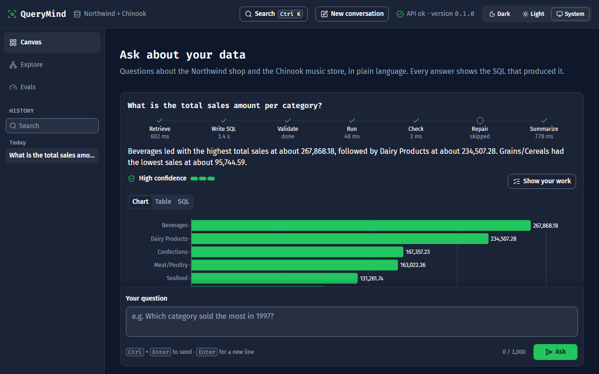
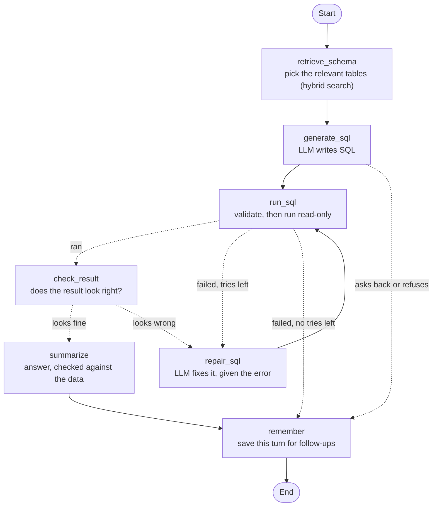

# QueryMind

[](https://github.com/Mohamed-Dahy/querymind/actions/workflows/ci.yml)

**An AI data analyst for company databases.** Ask a question in plain English and get back the answer,
a chart and a result table, and the SQL that produced it.

> "Which employee handled the most orders?" → "Margaret Peacock handled the most orders, with 156." + SQL + table



QueryMind is built to **assist** data teams, not replace them. It handles routine questions so analysts
can focus on deeper work, and it always shows its SQL so every answer can be checked.

> 🚧 **Status: working agent.** Ask questions in the web UI or through an HTTP API. The web UI shows each step
> of the agent live, the answer with its chart, table and SQL, saved conversations, a data explorer (tables,
> joins, business terms) and an evals lab with every measured score. When a query fails, the agent
> reads the database's error and fixes its own SQL; when a result looks wrong (no rows, duplicated rows), it
> checks again and warns you. When a question is ambiguous ("best customers": by revenue or by orders?) it asks
> back, and it politely refuses requests to change data. Every answer comes with a **confidence level** (High /
> Medium / Low) and the reasons behind it. Follow-up questions work too: "Top 5 customers by revenue", then
> "only for 1997", then "break that down by country". On a 30-question test set with known answers it gets
> **30/30** right (29/30 before self-correction). A **semantic layer** teaches it the company's own terms ("key
> accounts", "active customers", "turnover"): on 13 such questions it goes from 5/13 to 13/13. On a database with
> two businesses (25 tables), it sends the LLM only the tables a question needs, about 40% of the schema, and
> finds every needed table for all 58 test questions; verified example queries bring it to 58/58 correct. Every
> number is measured, including on the public **BIRD** benchmark: see [How accurate is it?](#how-accurate-is-it).
> Next: security and multi-user (PII masking, roles, per-user permissions).

---

## How it works

```
Question → LLM writes SQL → safety check → run on a read-only DB user → plain-language answer + table + SQL
```

The steps run as a [LangGraph](https://langchain-ai.github.io/langgraph/) agent graph. When a query is unsafe,
fails in the database or runs too long, the error goes back to the LLM, which writes a fixed query (up to 3 tries).
Before writing SQL, the LLM may instead ask a clarifying question with options (the question has several
reasonable meanings) or refuse (the user asks to change data); then no SQL runs. Every fixed query is checked
again before it runs. A result that looks wrong (no rows, duplicated rows) gets one
more try, and any warning that's left is shown with the answer.

Next to the schema, the LLM gets the company's **business definitions** from a reviewed YAML file (the semantic
layer): exact SQL for metrics like revenue or "key account", other names for tables ("clients" = customers) and
the preferred joins. Each one is checked against the database and run in the tests.

On a bigger database it doesn't send every table to the LLM. Each table and business term is described once and
stored as an embedding in **pgvector**; for each question, tables are ranked two ways, by meaning (vector search)
and by exact words (Postgres full-text search), and the two rankings are merged with Reciprocal Rank Fusion. The
top tables are sent, plus the tables needed to join them and the ones a business term reads. On 58 test
questions this hybrid search puts every needed table in the prompt. The same search also finds up to three
**verified example queries** for similar questions, shown to the LLM as patterns. They are written separately from
the test questions, and a test checks that none of them is a copy of one. On the 25-table demo database that's about 40% of the schema per
question. Retrieval only decides what the LLM *sees*: what it may *query* is still every table the read-only user
can read. If the search fails, the whole schema is sent and the logs say so.

Each turn of a conversation is remembered (the question, its SQL and the shape of its result, never the rows),
so the next question can build on it. Only the last 5 turns are kept.



The answer is checked too: every number in it must appear in the query result, or a plain sentence built from
the data is shown instead.

## Safety first

QueryMind runs SQL written by an AI, so the database is protected in layers:

- **Read-only database user.** The agent connects as `analyst_ro`, which can only `SELECT` from business
  tables. Every write (INSERT, UPDATE, DELETE, DROP, …) is blocked by Postgres itself. Tests prove this.
- **SQL validation.** Every generated query is parsed (sqlglot) and must be a single read-only `SELECT`, using
  only allowed tables and an allowlist of functions. Writes hidden in CTEs, system catalogs, `pg_sleep` and
  similar tricks are rejected before anything runs.
- **Query timeout and row limit.** Queries are stopped after 10 seconds and return at most 1,000 rows.
- **Audit trail.** Every question, re-run, sign-up, login (failed ones too) and logout is a row in the database:
  who, the question, the SQL, the tables, the row count, the time and how it ended. The app's database role can add
  rows but never change or delete them. Workspace admins read theirs at `GET /admin/audit`.
- **Secrets stay out of code.** All passwords and API keys come from environment variables.
- **Logins.** Every route except health, the evals page and login itself needs a signed access token (JWT,
  15 minutes). Passwords are stored only as Argon2id hashes. The refresh token sits in an httpOnly cookie, is
  replaced on every use, and a copied one that comes back logs that whole session out. Each user sees only their
  own conversations: someone else's reads as "doesn't exist". A test calls every route without a login.
- **Rate limits.** Per user (10 questions a minute, 200 a day), for everyone together (1,000 questions a day: it
  is our LLM key), on re-runs, and on logins per address and per email, so passwords can't be guessed in bulk.
  Over a limit: HTTP 429 with `Retry-After`, and the web UI counts down.
- **Saved keys, encrypted.** The LLM keys and database passwords users will save (bring your own key) are encrypted
  at rest, bound to their row (a copy moved to another account won't open), rotatable to a new key, and never
  logged or sent back: an LLM key shows only its last 4 characters. Log lines also hide anything shaped like a key.
- *Coming later:* PII masking, per-role table permissions and row-level security.

## How accurate is it?

Every number below comes from a real run of the full agent against a real database, scored automatically.
Runs were one question at a time. The web UI's **evals lab** shows these scores and every question behind them.

**What each part adds.** We switched the agent's parts on one at a time, all on the same model (Gemini 3.5
flash-lite), on 58 questions with known answers (30 Northwind, 13 business-term, 15 Chinook):

| Arm | What's on | Correct | Tokens / question |
|---|---|---|---|
| A | plain LLM, one try, the whole schema | 45/58 (78%) | 4,923 |
| B | + self-correction | 45/58 (78%) | 5,102 |
| C | + semantic layer (business definitions) | 57/58 (98%) | 6,724 |
| D | + schema retrieval and verified examples (the full agent) | **58/58 (100%)** | **3,454** |

The semantic layer is the biggest step: it teaches the company's own terms. Retrieval then sends only the tables a
question needs, which cuts tokens per question by about half, and the verified examples fix the last miss. On this model, first
tries almost never fail on these questions, so self-correction had nothing to repair.

**On a public benchmark.** On [BIRD Mini-Dev](https://bird-bench.github.io), a fixed sample of 100 questions over 11
databases the agent had never seen (same model, BIRD's official execution-accuracy rule):

| Arm | What's on | BIRD EX |
|---|---|---|
| A | plain LLM, no hints | 40/100 |
| B | + BIRD's evidence hints | 57/100 |
| C | + self-correction (the full agent) | 57/100 |

BIRD's hints play the same role as our semantic layer: +17 points. Self-correction adds nothing here either. It
repairs queries that fail or return suspicious results, and BIRD's misses are queries that run but answer a
slightly different question. Two runs of the same setup differ by about 3 questions.

**Which model.** The same full agent with only the LLM swapped, on 43 of those questions (30 Northwind, 13
business-term).
Cost is the list price for the tokens used:

| Model | Correct | Median time | Cost per correct answer |
|---|---|---|---|
| Gemini 3.5 flash-lite | 43/43 | 1.9 s | $0.00141 |
| Qwen 3.8 27B (Groq) | 42/43 | 4.1 s | $0.00415 |
| gpt-oss-20b (Groq) | 41/43 | 1.7 s | **$0.00041** |
| gpt-oss-120b (Groq) | 40/43 | 2.2 s | $0.00087 |

Two runs of the same setup differ by about 2 questions, so the accuracy gaps are mostly noise. Two of gpt-oss-120b's
three misses came from questions that fit both sample databases (each has its own customers and employees): once it
asked which one was meant, once it counted the other database's employees. The cost gap is real: gpt-oss-20b gives a correct answer for about a third of
flash-lite's price.

**Are the answers faithful?** A second LLM judged 29 answers with [DeepEval](https://github.com/confident-ai/deepeval):
29/29 relevant to the question and 27/29 faithful to the query result (both misses were the judge misreading names
with umlauts). Every number in an answer is also checked against the result rows in code. [RAGAS](https://docs.ragas.io)
confirms that retrieval finds every needed table for all 58 questions.

**A gate in CI.** Every change to the agent, the semantic layer or the evals runs 12 fixed questions through the real
agent and fails if more than one question that used to pass now fails. To prove the gate can fail, we broke the
agent on purpose on a test branch:
- **Schema removed from the prompt:** still 11/12, because the examples and self-correction recovered the table names.
- **"Always add LIMIT 1":** 8 questions failed, and the gate went red as it should.

The evals also run in parallel with [Ray](https://www.ray.io/) under one shared rate limiter: 100 BIRD questions in
508 s instead of 798 s with 4 workers, staying within the free tier's limits.

## Tech stack

| Area | Tools |
|---|---|
| Language | Python 3.12, [uv](https://docs.astral.sh/uv/) |
| Database | PostgreSQL 16 + pgvector (Docker) |
| Retrieval | Gemini embeddings, pgvector cosine search, Postgres full-text search, RRF |
| Agent | LangGraph |
| LLMs | Groq and Gemini through one interface (LangChain wrappers) |
| SQL safety | sqlglot |
| Auth | JWT access tokens (PyJWT), rotating refresh tokens, Argon2id password hashes |
| API | FastAPI (+ server-sent events for the live agent steps) |
| Web UI | React, Vite, TypeScript, Tailwind CSS, shadcn/ui (Radix), TanStack Query and Table, Recharts, React Flow |
| Config | pydantic-settings |
| Evals | BIRD Mini-Dev, own golden sets, DeepEval, RAGAS, Ray (parallel runs), an accuracy gate in GitHub Actions |
| Quality | ruff, mypy (strict), pytest, pre-commit; web: oxlint, Prettier, Vitest, Playwright + axe |
| CI | GitHub Actions |
| Planned | AWS (Bedrock, ECS), Terraform |

---

## Getting started

### Requirements
- [uv](https://docs.astral.sh/uv/getting-started/installation/) (it installs Python 3.12 for you)
- [Docker Desktop](https://www.docker.com/products/docker-desktop/)
- [Node.js 22](https://nodejs.org/) for the web UI
- An API key from [Groq](https://console.groq.com/keys) or [Google AI Studio](https://aistudio.google.com/apikey)

### Setup

```bash
git clone https://github.com/Mohamed-Dahy/querymind.git
cd querymind

uv sync                                # install dependencies
cp .env.example .env                   # then edit .env: passwords, your API key and JWT_SECRET
                                       # (Windows PowerShell: Copy-Item .env.example .env)

docker compose up -d --wait            # start Postgres + pgvector on 127.0.0.1:5433
uv run python data/seed_northwind.py   # load the sample data + create the read-only user
uv run python data/seed_chinook.py     # load the second sample (a music store) next to it
uv run python scripts/build_index.py   # index the tables for retrieval (needs a Google AI Studio key)
uv run python data/setup_app_db.py     # the app's own storage: accounts and saved conversations
```

The API needs `APP_DB_USER`, `APP_DB_PASSWORD` and `JWT_SECRET` in `.env` (it signs the login tokens; make one
with `uv run python -c "import secrets; print(secrets.token_urlsafe(48))"`). Scripts and evals don't need them.

Without a Google key the app still works: it sends the whole schema and logs a warning.

Optional, for the benchmark: `uv run python data/seed_bird.py` downloads [BIRD Mini-Dev](https://bird-bench.github.io)
(~800 MB, once, checked against a pinned hash) and loads its 11 databases, each into its own Postgres database.
The data is CC BY-SA 4.0 and is never committed here.

### Ask questions

```bash
uv run uvicorn querymind.api.main:app     # the API on http://127.0.0.1:8000 (docs at /docs)
uv run python scripts/ask.py "How many orders were placed in 1997?"   # or straight from the terminal
```

Then the web UI, in a second terminal:

```bash
npm --prefix web install          # once (and after package.json changes)
npm --prefix web run dev          # http://localhost:5173; /api is forwarded to the API on :8000
```

The web UI asks you to sign up or log in; the evals lab stays open without an account. The API itself: every
route except `/health`, `/evals` and the login routes needs a login. Sign up with `POST /auth/signup` (try it at
`/docs`), then send the `access_token` as `Authorization: Bearer …`. The token lasts 15 minutes; `POST /auth/refresh`
renews it from an httpOnly cookie.

To try the web UI with no database, API or LLM key: `npm --prefix web run dev:mock` answers from recorded real
replies (the screenshot above shows one of them), already logged in; any email and password work after "Log out".

### Measure accuracy

```bash
uv run python -m evals.run --suite golden   # 30 questions with known answers (uses real LLM calls)
uv run python -m evals.run --suite golden --max-attempts 1   # the same, with self-correction off
uv run python -m evals.clarify               # does it ask back only when a question is ambiguous?
uv run python -m evals.retrieval             # does retrieval find the tables each question needs?
uv run python -m evals.run --suite chinook --schema-retrieval off   # the whole schema, for comparison
uv run python -m evals.run --suite bird --limit 20 --provider gemini # BIRD benchmark (after seed_bird.py)
uv run python -m evals.run --suite bird --references-only           # check the benchmark's own SQL, no LLM
uv run python -m evals.rescore docs/eval-reports/<run>.json         # score a saved run again, no LLM calls
uv sync --group eval                                                 # Ray, for the parallel runs below
uv run python -m evals.run --suite bird --provider gemini --workers 4   # 4 questions at a time
```

Every run gives two scores: **BIRD EX**, the benchmark's official rule (the same set of rows, exactly), which is the
one to compare with the BIRD leaderboard, and **QueryMind match**, which judges the answer the way a person would
(column names, column order and rounding noise don't matter). Each question also records its LLM calls and tokens.
`--report run.md` writes `run.json` too, with every question's SQL, so a run can be scored again without the LLM.
With `--workers N`, N [Ray](https://www.ray.io/) workers answer questions at the same time, and every LLM call books
its slot with one shared rate limiter (requests and tokens per minute), so together they stay under the provider's
limits.

### Run the checks

```bash
uv run pytest                    # all tests (integration tests need the database running)
uv run pytest -m "not integration"  # unit tests only
uv run ruff check .              # lint
uv run mypy                      # type-check
npm --prefix web run lint        # web: lint (oxlint)
npm --prefix web run typecheck   # web: type-check (TypeScript)
npm --prefix web test            # web: unit and component tests (Vitest)
npm --prefix web run build && npm --prefix web run size   # web: production build + first-load size budget
npx --prefix web playwright install chromium   # once: the browser for the tests below
npm --prefix web run e2e         # web: every screen in a real browser, with accessibility checks (axe)
```
